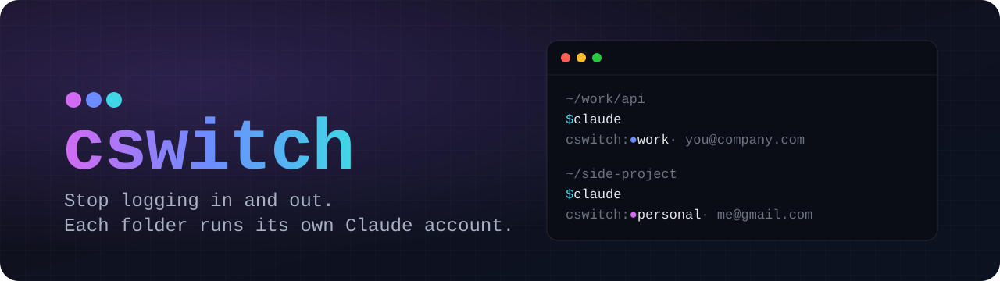

<p align="center">
  
</p>

# cswitch

Run multiple Claude Code accounts (say, work and personal) on the same machine, side by side,
without logging in and out. `cswitch` gives each account its own isolated identity while sharing
your settings and installed plugins, and picks the right one automatically based on which
directory you're in.

```
$ claude
cswitch: work · you@company.com · Acme Inc
```

## Install

```bash
npm i -g @biehcey/cswitch
```

Requires Node.js ≥ 20.19.

## Setup

Run `cswitch` with no arguments. On a first run it walks you through setup, then drops you into
the profile list:

```bash
cswitch
```

Setup registers your existing `~/.claude` as the default profile — it is never moved, copied, or
written to. (`cswitch init` does the same thing non-interactively.)

Next, create a profile for your other account and log in there:

```bash
cswitch add personal
cswitch personal -- claude
```

The second command runs `claude` inside the new profile, so the login flow opens there and the
credentials land in that profile instead of your existing one.

Finally, wire up your shell so plain `claude` goes through cswitch automatically:

```bash
# bash / zsh — add to ~/.bashrc or ~/.zshrc
eval "$(cswitch shell-init zsh)"

# fish — add to ~/.config/fish/config.fish
cswitch shell-init fish | source

# PowerShell — add to $PROFILE
cswitch shell-init powershell | Out-String | iex
```

## Daily use

Once the shell hook is installed, just run `claude` as usual — cswitch picks the profile bound to
your current directory (or the default profile if nothing matches) and runs `claude` there. The
one-line banner tells you which account you got:

```
cswitch: personal · you@gmail.com
cswitch: work · you@company.com · Acme Inc  [no binding — default]
```

`[no binding — default]` means no binding matched and you fell through to the default profile.
Silence it with `-q` or `CSWITCH_QUIET=1`.

To bind a directory to a profile — every path under it included:

```bash
cswitch bind ~/src/personal personal
```

When directories overlap, the longest matching prefix wins.

To override the binding for one command, name the profile explicitly:

```bash
cswitch personal -- claude
```

Anything after `--` is passed through untouched, and it doesn't have to be `claude`:

```bash
cswitch work -- claude mcp list
cswitch work -- node script.js
```

### Interactive mode

Running `cswitch` with no arguments (on a real terminal) opens the profile list:

```
                        _  _          _
    ___  ___ __      __(_)| |_   ___ | |__
   / __|/ __|\ \ /\ / /| || __| / __|| '_ \
  | (__ \__ \ \ V  V / | || |_ | (__ | | | |
   \___||___/  \_/\_/  |_| \__| \___||_| |_|
  stop logging out: each folder runs its own Claude account

  PROFILES
  ● work       you@company.com · Acme Inc   default   5h 91% · week 63%
> ● personal   you@gmail.com                          5h 12% · week 4%

  RECENT
  api-server   ● work       2h ago   ~/code
  dotfiles     ● personal   3d ago   ~

  ↑↓ move · enter run · c continue · r resume · m mcp · a add · d remove · esc quit
```

Each profile has its own colored dot, repeated on its RECENT rows. A profile that isn't logged in
shows a red `(not logged in)` where its account would be.

The end of each row shows how full that account's 5-hour and weekly Claude limits are — the same
numbers `/usage` shows inside Claude Code — so you can see which account still has room before you
pick one. They turn yellow from 80% and red from 95%. The list opens right away and the numbers
fill in a moment later; a profile whose login has expired, or any network trouble, simply shows no
numbers. To get them, cswitch reads each profile's own login token (read-only, never refreshed or
stored) and asks Anthropic, exactly as Claude Code does. Set `CSWITCH_NO_USAGE=1` to turn this off.

Arrow keys move, `enter` runs `claude` in the selected profile, `a` adds a profile, `d` deletes
one, `esc` quits. Three more keys run the `claude` invocations you reach for daily, in the
selected profile:

| Key | Runs |
| --- | --- |
| `c` | `claude --continue` |
| `r` | `claude --resume` |
| `m` | `claude mcp list` |

Selecting a profile here is a one-off launch: nothing is written and no binding is touched. When
the command you started finishes, `cswitch` finishes with it — the list does not reopen. The
default profile can't be deleted from here — backing that out means removing `~/.cswitch`
entirely — but every launch key works on it like any other row.

RECENT lists the last 10 directories you ran `claude` in, read from each profile's own Claude Code
history, one row per directory and profile. `enter`, `c`, `r` and `m` on a RECENT row run in that
directory with that row's profile — even if the directory is bound to another profile, in which
case the row is marked `≠binding`. `d` does nothing there. Your shell stays where it was.

In a pipe, a script, or CI there is no terminal to drive, so a bare `cswitch` prints help and
exits instead.

## Commands

| Command | What it does |
| --- | --- |
| `cswitch` | Interactive mode; runs setup first if `~/.cswitch` doesn't exist |
| `cswitch [<profile>] -- <cmd>` | Run a command in a profile's environment |
| `cswitch init [--name <name>]` | Set cswitch up, adopting `~/.claude` as-is |
| `cswitch add <name> [--bind <dir>]` | Create a profile, optionally binding a directory in one step |
| `cswitch remove <name> [--force]` | Delete a profile — asks for confirmation first |
| `cswitch bind <dir> <profile>` | Bind a directory prefix to a profile |
| `cswitch bind --list` | List every binding |
| `cswitch unbind <dir>` | Remove a binding |
| `cswitch status [--json]` | Show what runs here, plus every profile and any warnings |
| `cswitch recent` | List the directories you last ran `claude` in, per profile |
| `cswitch shell-init <shell>` | Print the `claude` wrapper for bash, zsh, fish, or powershell |

`cswitch status` is the one to reach for when something looks wrong:

```
$ cswitch status
Here: /Users/you/src/personal
  Profile   personal  (binding: /Users/you/src/personal)
  Account   you@gmail.com

Profiles
  work *  you@company.com · Acme Inc  (* in place: ~/.claude)
  personal  you@gmail.com
```

It is entirely local — it never reaches the network and never spawns `claude`. `--json` gives the
same report as a stable structure; the plain-text layout is not a promise.

`cswitch remove` deletes the profile's directory, its config record, and any bindings pointing at
it, and on macOS best-effort deletes its Keychain entry. It refuses to remove the default profile.

The wrapped command's exit code is passed through unchanged. cswitch's own failures use 64
(usage) and 70 (runtime), so they never look like a `claude` exit code.

## Uninstall

Delete `~/.cswitch` and remove the `cswitch shell-init` line from your shell profile. Your
default account is untouched — `~/.claude` was never moved or modified, so plain `claude`
keeps working exactly as before.

```bash
rm -rf ~/.cswitch
```

## Known limits

- No `cmd.exe` support — use PowerShell on Windows.
- IDE and editor plugins are out of scope; `CLAUDE_CONFIG_DIR` only affects the CLI.
- Global config keys (`autoConnectIde`, `diffTool`, and similar) are not shared between
  profiles — each one is set up independently.
- Usage limits come from an undocumented Anthropic endpoint; if it changes, the numbers quietly
  stop showing. On macOS, profiles other than the default one depend on a guessed Keychain entry
  name and may show no numbers.
- "Logged in" means a profile holds an account, not that its session is still valid — whether a
  token has expired is Claude Code's business, not cswitch's.

---

To try cswitch without installing it globally: `npx @biehcey/cswitch@latest`.
